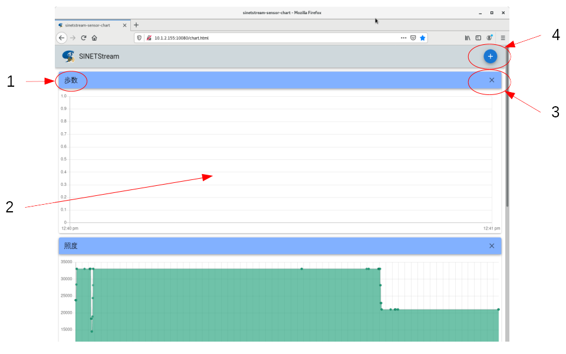
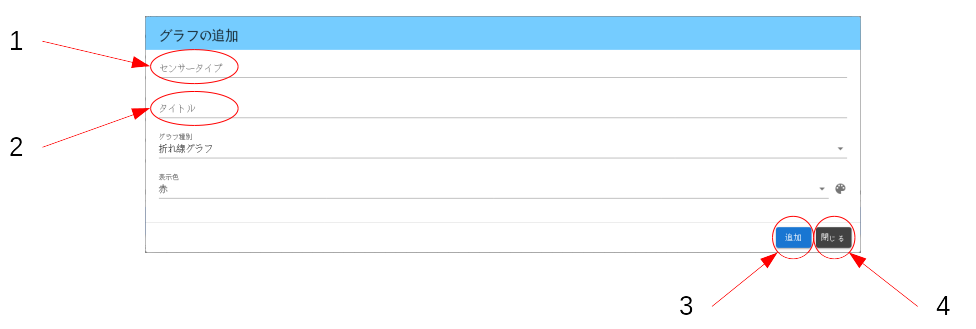

<!--
Copyright (C) 2020-2021 National Institute of Informatics

Licensed to the Apache Software Foundation (ASF) under one
or more contributor license agreements.  See the NOTICE file
distributed with this work for additional information
regarding copyright ownership.  The ASF licenses this file
to you under the Apache License, Version 2.0 (the
"License"); you may not use this file except in compliance
with the License.  You may obtain a copy of the License at

  http://www.apache.org/licenses/LICENSE-2.0

Unless required by applicable law or agreed to in writing,
software distributed under the License is distributed on an
"AS IS" BASIS, WITHOUT WARRANTIES OR CONDITIONS OF ANY
KIND, either express or implied.  See the License for the
specific language governing permissions and limitations
under the License.
-->

[日本語](TUTORIAL-android-step2-webbrowser.md)

# TUTORIAL - A web interface for the sensor data visualization

<em>Table of contents</em>
<pre>
1. Introduction
2. Connecting to the web server
3. The main window
3.1 Window layout
3.2 Removing a graph
4. The settings dialog
4.1 Dialog layout
4.2 Sensor types
</pre>


## 1. Introduction

The back-end system for the STEP2 tutorial
provides a web interface for the sensor data visualization.
By connecting to the designated URL from a web browser, user can
monitor sensor readout values per type being plotted as real-time
graphs.


## 2. Connecting to the web server

While the back-end system is up and running, connect to the
following URL from a web browser on an observing PC.
You can use your smartphone or tablet instead, of course.

```
    http://<server_address>/
```

The `server_address` element of the URL, specified by IP address
or FQDN (Fully Qualified Domain Name), is for the host machine
which runs the container image for the back-end system.
If the port number of the web server is not using the standard `80`,
specify the `server_address` as `<address>:<port>` format.

If you cannot connect to the web server even if the URL is correct,
it is likely to be a generic network problem.
Check for the end-end IP reachability (routing and firewall).
If you specify the `server_address` by FQDN, check if DNS works.


## 3. The main window
### 3.1 Window layout

The main window has a header and a body.
The header contains the title and a settings button (gear icon).
The body is constructed as a vertical list of graph cards per sensor type.



\<Legends\>
1. Title
2. Settings button (gear icon)
3. Graph card per sensor type
4. Close button (x) on each graph card

While the Android application "Sensor" is running, sensor readout
values are almost periodically published to the `Broker`, and then
processed by the back-end server to store them sequentially.
As long as the new sensor readout values are added in the database,
graph display region will be automatically updated.

In the main window, there are three graph display regions as the
initial setup.

* light
* magnetic_field
* gravity

To adapt the available sensor implementations on the Android device,
or to adapt the user-desired sensor types, user can change the
displayed sensor types via the settings dialog.
Press the settings button (gear icon) to open the settings dialog.

The modified window layout is saved in the local storage of your web
browser. So if you restart the web browser and connect to the web
server next time, saved layout is deployed.


### 3.2 Removing a graph

Press the close button (x) on the top-right corner of each graph card
to remove the graph display region for that sensor type.


## 4. The settings dialog
### 4.1 Dialog layout

By pressing the settings button (gear icon) on the top-right corner
of the main window, the settings dialog as shown below will pop up.



\<Legends\>
1. Refresh Interval (seconds): Set the auto-refresh interval for graphs (default: 3 seconds).
2. Max Display Range (minutes): Set the time span displayed on graphs (default: 60 minutes).
3. Sensor type list: Select sensor types to display using checkboxes.
4. `Select All` button: Enable all sensor types.
5. `Clear All` button: Disable all sensor types.
6. `OK` button: Commit the settings and close this dialog.
7. `Close` button: Cancel the edit work and close this dialog.

Turn on the checkboxes for the sensor types you want to display,
then press the `OK` button to commit.
You can cancel at any time by pressing the `Close` button.


### 4.2 Sensor types

Following is the list of sensor type available on this tutorial.

* The 1st column `Type` and the 2nd column `Symbol` corresponds to
the constants defined in the Android developer document
[Sensor](https://developer.android.com/reference/android/hardware/Sensor).

* Watch the 3rd column `TypeName` in the table.
This value (such like `accelerometer`) is the name shown in the
sensor type list of the settings dialog.

* Note that available sensor types may vary depending on the hardware
implementation or Android version of the device.


|Type|Symbol|TypeName|
|---|---|---|
|1|Sensor.TYPE_ACCELEROMETER|accelerometer|
|2|Sensor.TYPE_MAGNETIC_FIELD|magnetic_field|
|4|Sensor.TYPE_GYROSCOPE|gyroscope|
|5|Sensor.TYPE_LIGHT|light|
|6|Sensor.TYPE_PRESSURE|pressure|
|8|Sensor.TYPE_PROXIMITY|proximity|
|9|Sensor.TYPE_GRAVITY|gravity|
|10|Sensor.TYPE_LINEAR_ACCELERATION|linear_acceleration|
|11|Sensor.TYPE_ROTATION_VECTOR|rotation_vector|
|14|Sensor.TYPE_MAGNETIC_FIELD_UNCALIBRATED|magnetic_field_uncalibrated|
|15|Sensor.TYPE_GAME_ROTATION_VECTOR|game_rotation_vector|
|16|Sensor.TYPE_GYROSCOPE_UNCALIBRATED|gyroscope_uncalibrated|
|17|Sensor.TYPE_SIGNIFICANT_MOTION|significant_motion|
|18|Sensor.TYPE_STEP_DETECTOR|step_detector|
|19|Sensor.TYPE_STEP_COUNTER|step_counter|
|20|Sensor.TYPE_GEOMAGNETIC_ROTATION_VECTOR|geomagnetic_rotation_vector|
|35|Sensor.TYPE_ACCELEROMETER_UNCALIBRATED|accelerometer_uncalibrated|

